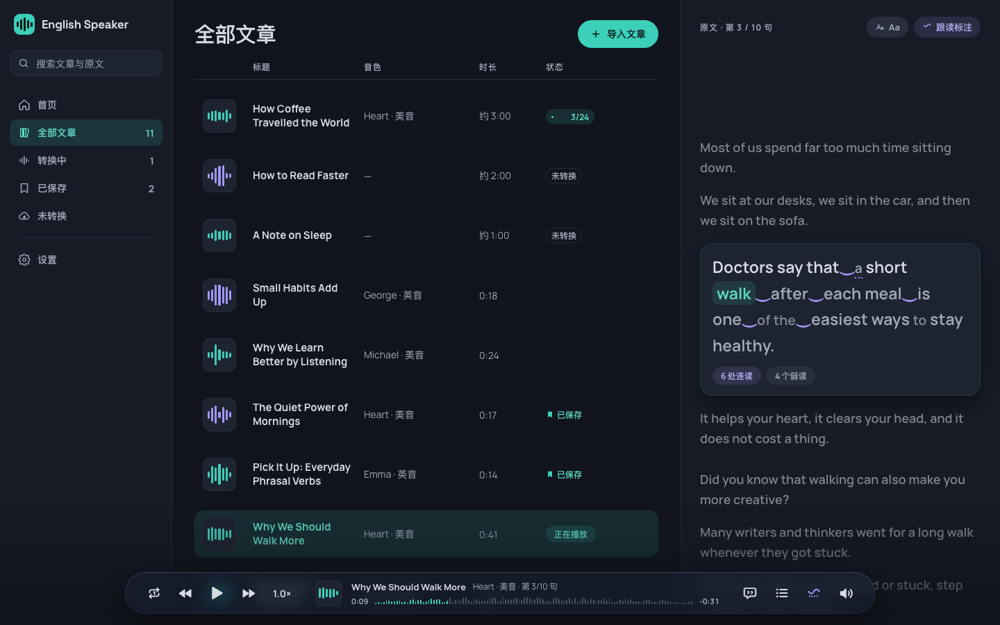
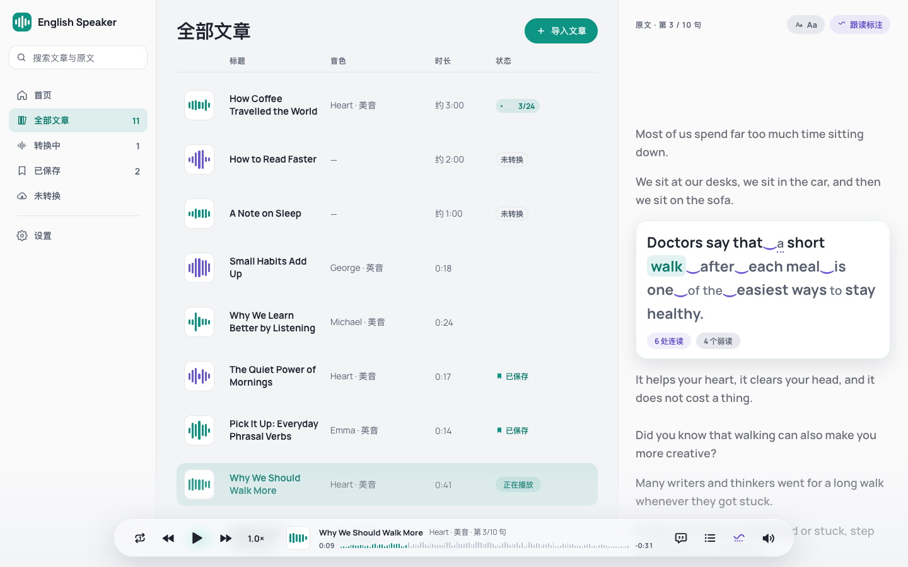
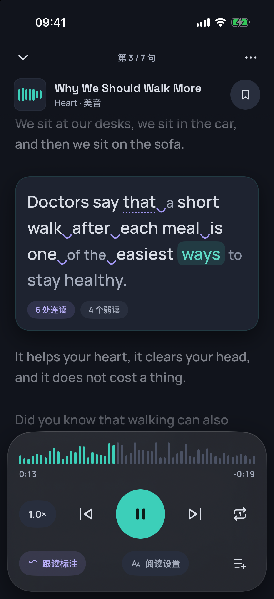
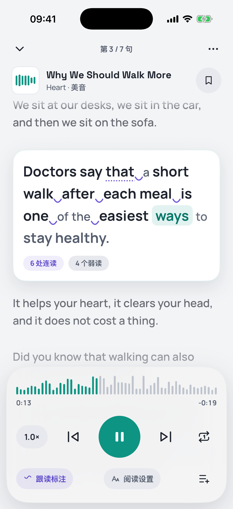
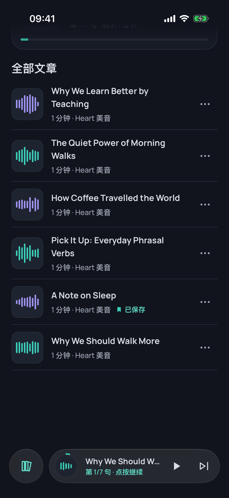
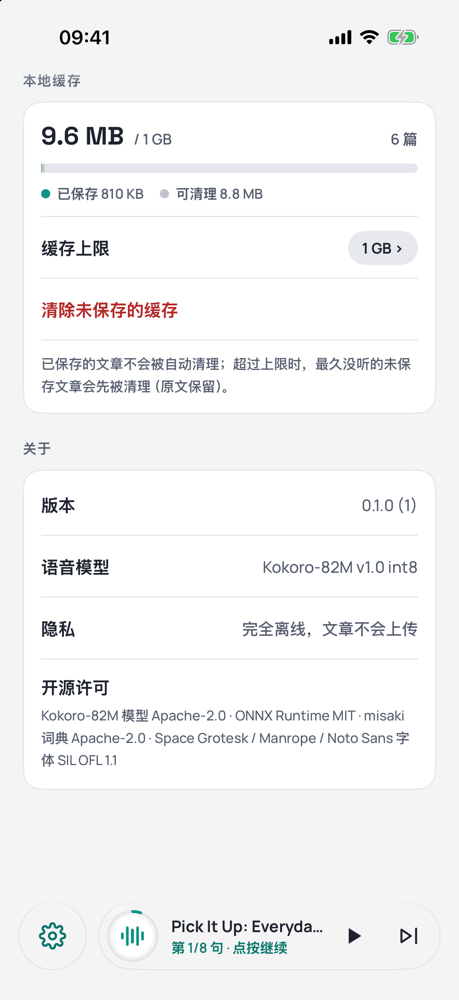
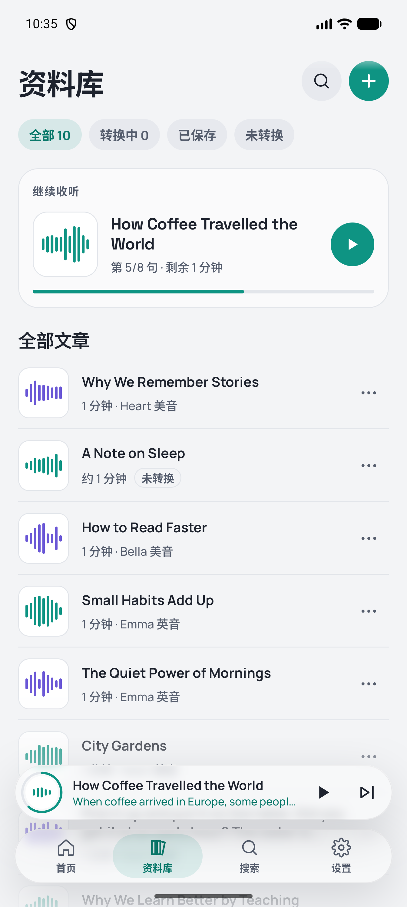
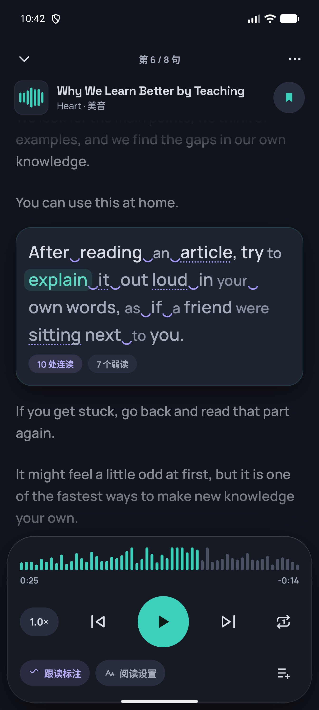
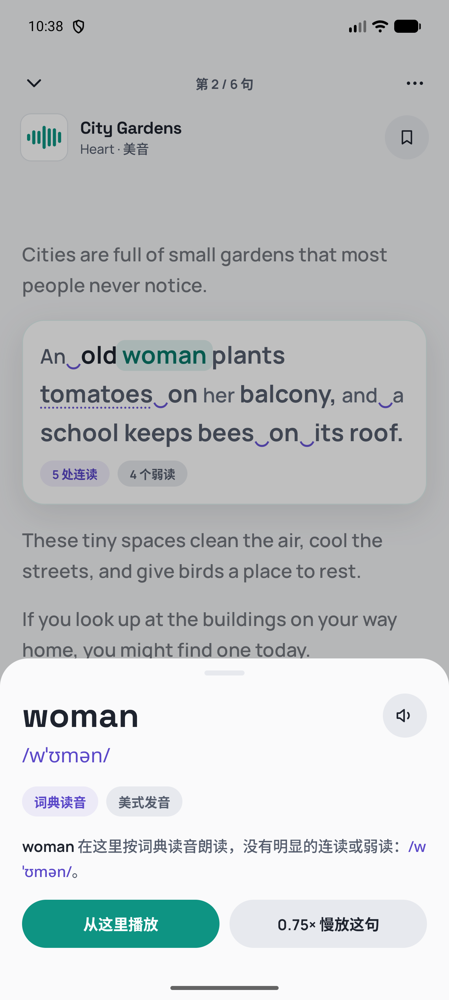
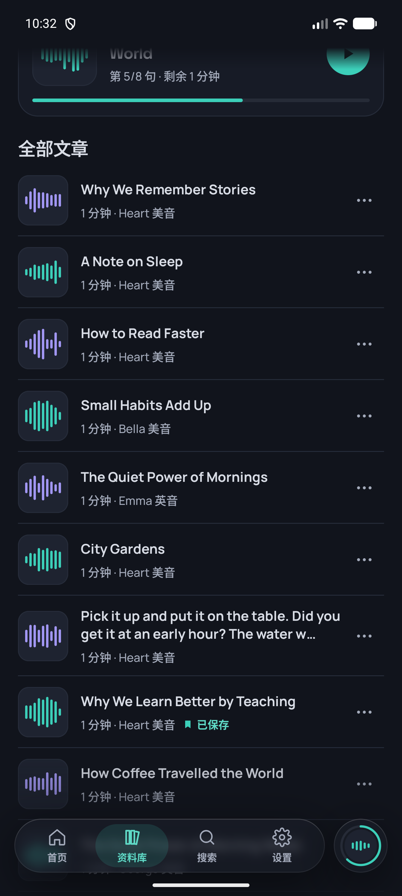

<div align="center">

# English Speaker

**把英文文章变成可以跟读的语音播客——完全离线，模型跑在你自己的设备上。**

Turn any English article into a podcast you can read along with — fully offline, on-device TTS.

Windows · macOS · Linux · iOS · Android

</div>

## 截图

**桌面端**（Windows / macOS / Linux）

<p align="center">
  
  
</p>

**iOS**：播放页 · 底部栏收起 · 设置

<p align="center">
  
  
  
  
</p>

**Android**：资料库 · 点词读音 · 底部栏展开

<p align="center">
  
  
  
  
</p>

更多截图见 [docs/screenshots/v2](docs/screenshots/v2)。

## 特性

- **完全离线**：使用开源的 [Kokoro-82M](https://huggingface.co/hexgrad/Kokoro-82M) 模型在端侧合成语音，文章不会上传到任何服务器。模型已随仓库提供（`models/kokoro`，约 100MB）。
- **边听边转**：导入文章后立刻开始转换，像在线播放一样一边合成一边收听；合成追不上时自动缓冲，中断后从断点续转。
- **本地缓存池**：音频按句分块写入本地，SQLite 记录索引；LRU 自动淘汰，“已保存”的文章永久保留，上限可在设置里调整。
- **逐词高亮 + 跟读标注**：原文跟随朗读逐词高亮，并标出连读（`pick‿it‿up`）、弱读、闪音、同化与省音；点任意词查看 IPA 与中文说明。
- **为长时专注设计**：夜间“石墨”/ 白天“柔灰”双主题，对比度控制在 7–14:1；当前句固定在视线高度；专注模式自动收起控件。
- **一套核心，五个平台**：业务逻辑全部在 Rust 核心层，各平台只负责界面与放声音。

## 架构

```
┌──────────── 平台层（只做界面和音频输出） ────────────┐
│  iOS：SwiftUI     Android：Compose     PC：CEF + Svelte │
└───────────────┬───────────────────────────────────────┘
                │  UniFFI（Swift / Kotlin） · JSON 桥（桌面）
┌───────────────┴──────────── Rust 核心层 ──────────────┐
│ es-core      文章、句子切分、连读分析、调度、播放状态机 │
│ es-tts-kokoro  Kokoro 推理（ONNX Runtime）+ misaki G2P │
│ es-storage   SQLite 缓存池     es-audio   PCM 分块编解码 │
│ es-runtime   组装   es-ffi  移动端绑定   es-desktop 桌面宿主 │
└───────────────────────────────────────────────────────┘
```

详见 [docs/ARCHITECTURE.md](docs/ARCHITECTURE.md)；界面规范见 [docs/UI_SPEC.md](docs/UI_SPEC.md)，设计稿用浏览器打开 [docs/design/visual-v2.html](docs/design/visual-v2.html)。

## 快速开始

需要：Rust 1.86+；iOS 需要 Xcode 16+ 与 [xcodegen](https://github.com/yonaskolb/XcodeGen)；Android 需要 Android SDK/NDK 与 `cargo-ndk`；桌面 Web 界面需要 Node.js 20+。

```bash
git clone https://github.com/lingdikong/english_speaker.git
cd english_speaker

cargo test --workspace                     # 核心层测试（有模型时同时跑真实引擎）

# 命令行试听：边听边转
ES_MODEL_DIR=models cargo run --release -p es-desktop -- speak article.txt
```

| 平台 | 构建 |
|---|---|
| iOS / macOS | `scripts/build-apple.sh`，然后 `cd platforms/apple/App && xcodegen` 并用 Xcode 打开 |
| Android | `scripts/build-android.sh`，然后用 Android Studio 打开 `platforms/android` |
| 桌面（开发） | `cd ui/web && npm ci && npm run build`，然后 `ES_MODEL_DIR=models cargo run --release -p es-desktop -- serve --open`（本地浏览器窗口） |
| 桌面（CEF） | `cargo run --release -p es-desktop --features cef -- app`；macOS 打包：`crates/es-desktop/scripts/bundle-macos.sh --release --copy-models` |

模型文件已在仓库中；如需重新下载或切换精度：`VARIANT=fp16 scripts/fetch-models.sh`。

## 目录

```
crates/          Rust 核心层（es-core / es-tts-kokoro / es-storage / es-audio / es-runtime / es-ffi / es-desktop）
platforms/apple  iOS App（SwiftUI）与 SpeakerCore Swift Package
platforms/android Android App（Jetpack Compose）
ui/web           桌面端 Web 界面（Svelte），运行在 CEF 中
models/kokoro    Kokoro-82M int8 模型、音色与 G2P 词典
docs/            架构、界面规范、设计稿与截图
scripts/         构建与模型下载脚本
```

## 许可

本项目代码以 [Apache License 2.0](LICENSE) 发布。

随仓库分发的第三方内容保留各自的许可：Kokoro-82M 模型与音色、misaki 词典为 Apache-2.0（见 [models/kokoro/README.md](models/kokoro/README.md)），字体为 SIL OFL 1.1。

## 致谢

感谢 [hexgrad](https://huggingface.co/hexgrad) 开源 Kokoro-82M 与 misaki，感谢 [StyleTTS 2](https://github.com/yl4579/StyleTTS2) 的作者，感谢 [onnx-community](https://huggingface.co/onnx-community) 提供 ONNX 版本，以及 ONNX Runtime、UniFFI、SQLite、Chromium Embedded Framework、Svelte、Jetpack Compose、Haze 等所有开源项目。完整列表见 [ACKNOWLEDGEMENTS.md](ACKNOWLEDGEMENTS.md)。
